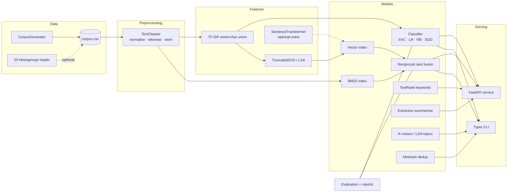

# Newsroom NLP

A text-intelligence toolkit and HTTP API for news and article text. It covers the full
lifecycle of a small newsroom NLP stack — preprocessing, supervised classification, dense
embeddings, BM25 / vector / hybrid search, keyword extraction, topic discovery, extractive
summarisation, near-duplicate detection and evaluation — with a Typer CLI and a FastAPI
service on top.

Everything runs **fully offline** with numpy, pandas, scipy and scikit-learn. Heavier models
(sentence-transformers, UMAP, NLTK) are optional extras hidden behind provider abstractions
that fall back to scikit-learn implementations.

## Features

| Area | What you get |
| --- | --- |
| Data | Deterministic synthetic news corpus generator (6 categories, thousands of varied documents), optional 20 Newsgroups loader |
| Preprocessing | Unicode normalisation, URL/e-mail/number handling, contraction expansion, regex tokeniser, built-in stopwords, self-contained Porter-style stemmer, n-gram helpers, scikit-learn compatible `TextCleaner` |
| Features | Word + character TF-IDF `FeatureUnion`, hashing vectoriser, LSA (`TruncatedSVD`) embeddings |
| Embeddings | `EmbeddingProvider` protocol, offline `TfidfSvdProvider`, optional `SentenceTransformerProvider`, content-hash disk cache |
| Classification | `LinearSVC`, `LogisticRegression`, `ComplementNB`, `SGDClassifier` with calibrated probabilities, `GridSearchCV`, joblib persistence, coefficient-based explanations |
| Search | In-memory cosine vector index (incremental add, save/load), own BM25 implementation, reciprocal-rank-fusion hybrid search |
| Keywords | TextRank on a co-occurrence graph (numpy power iteration), corpus-aware TF-IDF keywords |
| Topics | K-means / MiniBatchKMeans with silhouette-based `k` selection and top terms per cluster, LDA wrapper |
| Similarity | MinHash + LSH near-duplicate detection, cosine-threshold alternative |
| Summarisation | Extractive summaries via TF-IDF centroid or sentence-graph TextRank with redundancy penalty |
| Evaluation | Accuracy / macro-micro-weighted F1 / per-class / confusion matrix; Precision@k, Recall@k, MRR, nDCG@k on generated relevance sets; Markdown + JSON reports |
| Visualisation | Confusion-matrix heatmap, class distribution, 2-D embedding projection, top-terms charts (headless PNG) |
| API | FastAPI with pydantic v2 schemas, lifespan artifact loading, optional API-key auth, global error handlers |
| CLI | `newsroom generate-corpus | train | evaluate | build-index | search | keywords | summarize | cluster | dedup | serve` |

## Architecture



Package layout (`src/newsroom`):

| Module | Responsibility |
| --- | --- |
| `data/corpus.py` | Synthetic corpus generation, CSV IO, 20 Newsgroups loader |
| `preprocessing/` | `text.py` (cleaning, tokenisation, `TextCleaner`), `stemmer.py`, `stopwords.py` |
| `features/vectorizers.py` | TF-IDF union, hashing, LSA pipeline factories |
| `embeddings/` | `base.py` (protocol + factory), `tfidf_svd.py`, `sentence_transformers_provider.py`, `cache.py` |
| `classification/` | `trainer.py`, `predictor.py`, `explain.py` |
| `search/` | `index.py`, `bm25.py`, `hybrid.py`, `query.py` (`SearchEngine`) |
| `keywords/` | `textrank.py`, `tfidf_keywords.py` |
| `topics/` | `clustering.py`, `lda.py` |
| `similarity/dedup.py` | MinHash / LSH near-duplicate detection |
| `summarization/extractive.py` | Centroid and TextRank sentence selection |
| `evaluation/` | `metrics.py`, `search_eval.py`, `report.py` |
| `visualization/plots.py` | Matplotlib PNG figures (Agg backend) |
| `api/` | `app.py`, `routes.py`, `schemas.py`, `state.py`, `deps.py` |
| `config.py`, `cli.py`, `utils/` | Settings (pydantic-settings), Typer CLI, logging / IO / hashing helpers |

## Setup

Requires Python 3.10+.

```bash
python -m venv .venv
# Windows: .venv\Scripts\activate    macOS/Linux: source .venv/bin/activate
pip install -e ".[dev]"

# optional extras
pip install -e ".[transformers]"   # sentence-transformers provider (downloads models on first use)
pip install -e ".[umap]"           # UMAP projections
pip install -e ".[nltk]"           # NLTK Porter stemmer instead of the built-in one
```

Configuration is read from environment variables prefixed with `NEWSROOM_` (or a `.env`
file); see [`.env.example`](.env.example). Nothing needs to be set for the defaults.

## Usage

### CLI

```bash
# 1. Generate a labelled corpus (2 000 documents, 6 categories)
newsroom generate-corpus --n-docs 2000 --output artifacts/corpus.csv

# 2. Train a calibrated LinearSVC (grid search, settings from YAML)
newsroom train --input artifacts/corpus.csv --output artifacts/classifier.joblib \
               --config configs/classifier.yaml
# or quickly, without grid search:
newsroom train --model complement_nb --no-grid-search

# 3. Build BM25 + vector indexes
newsroom build-index --input artifacts/corpus.csv --output artifacts/index --config configs/search.yaml

# 4. Evaluate classifier and retrieval, write Markdown/JSON reports and PNG plots
newsroom evaluate --input artifacts/corpus.csv --model artifacts/classifier.joblib \
                  --index artifacts/index --report-dir artifacts/reports

# 5. Query
newsroom search "central bank raises interest rates amid inflation" --top-k 5
newsroom search "late penalty in the cup final" --mode bm25 --json

# 6. Single-document utilities
newsroom keywords "The central bank raised interest rates on Wednesday citing persistent inflation." --top-k 5
newsroom summarize --file article.txt --sentences 2 --method textrank

# 7. Corpus analytics
newsroom cluster --input artifacts/corpus.csv --lda --output artifacts/reports/clusters.json
newsroom dedup --input artifacts/corpus.csv --threshold 0.6

# 8. Serve the API
newsroom serve --artifacts artifacts --port 8000
```

`scripts/demo_pipeline.sh` (or `scripts/demo_pipeline.ps1` on Windows) runs steps 1–7 end
to end. A 300-row sample corpus is committed at `data/sample/articles_sample.csv` for a
quick start without generating anything.

### Python API

```python
from newsroom.data.corpus import generate_corpus
from newsroom.classification.trainer import TrainConfig, train_classifier
from newsroom.classification.predictor import Predictor
from newsroom.classification.explain import top_terms_per_class
from newsroom.search.query import build_search_engine
from newsroom.keywords.textrank import TextRankExtractor
from newsroom.summarization.extractive import ExtractiveSummarizer

df = generate_corpus(n_docs=2000, seed=42)

result = train_classifier(df, TrainConfig(model="linear_svc", grid_search=True))
predictor = Predictor(result.pipeline)
print(predictor.predict("Shares slid after the retailer cut its profit forecast").top(3))
print(top_terms_per_class(result.pipeline, n_terms=5)["sports"])

engine = build_search_engine(df, provider_name="tfidf_svd", dimension=256)
for hit in engine.search("vaccine trial results", top_k=3, mode="hybrid"):
    print(hit.rank, hit.label, hit.title, hit.component_scores)

print([k.text for k in TextRankExtractor().extract(df["text"][0], top_k=5)])
print(ExtractiveSummarizer("textrank").summarize(df["text"][0], n_sentences=2).text)
```

### HTTP API

Start with `newsroom serve` (or `docker compose up`). Interactive docs live at
`http://localhost:8000/docs`.

| Method | Path | Purpose |
| --- | --- | --- |
| GET | `/health` | Liveness + which artifacts are loaded |
| GET | `/models` | Classifier / embedding / index metadata |
| POST | `/classify` | Labels with calibrated probabilities, optional explanations |
| POST | `/embed` | Dense vectors from the active provider |
| POST | `/search` | Hybrid / BM25 / vector search with per-request weights |
| POST | `/keywords` | TextRank keywords for a document |
| POST | `/summarize` | Extractive summary |
| POST | `/index/documents` | Add documents to the index (creates it if none is loaded) |

```bash
curl -s localhost:8000/classify -H 'content-type: application/json' \
  -d '{"texts": ["The goalkeeper saved a late penalty in the cup final"], "top_k": 3, "explain": true}'

curl -s localhost:8000/search -H 'content-type: application/json' \
  -d '{"query": "interest rates inflation", "top_k": 5, "mode": "hybrid", "bm25_weight": 1.0, "vector_weight": 1.5}'

curl -s localhost:8000/index/documents -H 'content-type: application/json' \
  -d '{"documents": [{"doc_id": "x1", "text": "A volcanic eruption sent lava toward villages.", "label": "science"}]}'
```

Set `NEWSROOM_API_KEY=<secret>` to require an `X-API-Key` header on every `POST` endpoint
(`/health` and `/models` stay public). Authentication is disabled by default.

## Evaluation results

Measured on the default synthetic corpus (`generate-corpus --n-docs 2000`, seed 42),
stratified 80/20 hold-out, single CPU core. The corpus mixes category-specific and shared
sentence templates and leaks 30% of slot vocabulary across categories, so it is
deliberately not trivially separable.

**Classification (hold-out, 400 documents)**

| Model | Accuracy | Macro F1 | Train time |
| --- | --- | --- | --- |
| LinearSVC (calibrated, grid search, `configs/classifier.yaml`) | **0.9925** | **0.9925** | 25 s |
| LogisticRegression | 0.9900 | 0.9900 | 1.2 s |
| LinearSVC (calibrated, no grid search) | 0.9875 | 0.9875 | 1.0 s |
| ComplementNB | 0.9875 | 0.9875 | 0.7 s |
| SGD (modified Huber) | 0.9875 | 0.9875 | 0.8 s |

Per-class F1 for the best model ranges from 0.997 (business, science) to 1.000 (politics,
technology).

**Retrieval (100 generated queries, k = 10, relevance = same label; source document gain 3)**

| Mode | P@10 | R@10 | MRR | nDCG@10 |
| --- | --- | --- | --- | --- |
| BM25 | **0.736** | 0.022 | **0.920** | **0.790** |
| Vector (TF-IDF + SVD-256) | 0.716 | 0.021 | 0.889 | 0.757 |
| Hybrid (RRF, k=60) | 0.729 | 0.022 | 0.907 | 0.783 |

Recall@10 is bounded by 10 / 333 relevant documents per query (≈ 0.03), so P@10, MRR and
nDCG are the informative numbers here. On this vocabulary-driven synthetic corpus lexical
matching is very strong; hybrid retrieval pays off more on real text where paraphrase
matters, and the sentence-transformers provider can be dropped in without code changes.

Reproduce with `make demo` or `scripts/demo_pipeline.sh`; reports land in
`artifacts/reports/evaluation.{md,json}` alongside PNG plots.

## Testing

```bash
pytest                       # ~130 tests, fully offline, < 10 s
pytest --cov=newsroom        # with coverage
ruff check src tests && black --check src tests && mypy
```

Tests cover preprocessing, vectorisers, embedding providers and the cache, classifier
train/predict/explain, BM25, the vector index, hybrid fusion, TextRank, clustering and
LDA, the summariser, MinHash dedup, classification and retrieval metrics, report writers,
plots, the CLI (`CliRunner`) and the API (`TestClient`, including auth and degraded mode).
A small corpus and models are built once per session in `tests/conftest.py`.

`make lint`, `make typecheck`, `make test-cov` and `.pre-commit-config.yaml` mirror the
GitHub Actions workflow in `.github/workflows/ci.yml` (Python 3.10–3.12 + Docker build).

## Docker

```bash
docker build -t newsroom-nlp .          # trains a default model + index at build time
docker compose up                       # API on http://localhost:8000
```

## Project structure

```
newsroom-nlp/
├── configs/                  # classifier.yaml, search.yaml
├── data/sample/              # articles_sample.csv (300 generated rows)
├── notebooks/                # 01_text_exploration, 02_classification, 03_semantic_search
├── scripts/                  # demo_pipeline.sh / demo_pipeline.ps1
├── src/newsroom/
│   ├── api/                  # FastAPI app, routes, schemas, state, deps
│   ├── classification/       # trainer, predictor, explain
│   ├── data/                 # corpus generator + loaders
│   ├── embeddings/           # provider protocol, TF-IDF/SVD, sentence-transformers, cache
│   ├── evaluation/           # metrics, search_eval, report
│   ├── features/             # vectorizer factories
│   ├── keywords/             # textrank, tfidf_keywords
│   ├── preprocessing/        # text, stemmer, stopwords
│   ├── search/               # index, bm25, hybrid, query
│   ├── similarity/           # dedup
│   ├── summarization/        # extractive
│   ├── topics/               # clustering, lda
│   ├── utils/                # logging, io, hashing
│   ├── visualization/        # plots
│   ├── cli.py                # Typer entry point (`newsroom`)
│   └── config.py             # pydantic-settings
├── tests/                    # pytest suite
├── .github/workflows/ci.yml
├── Dockerfile · docker-compose.yml · Makefile · pyproject.toml
└── .env.example · .pre-commit-config.yaml · LICENSE (MIT)
```

## License

MIT — Copyright (c) 2026 Adnan.
